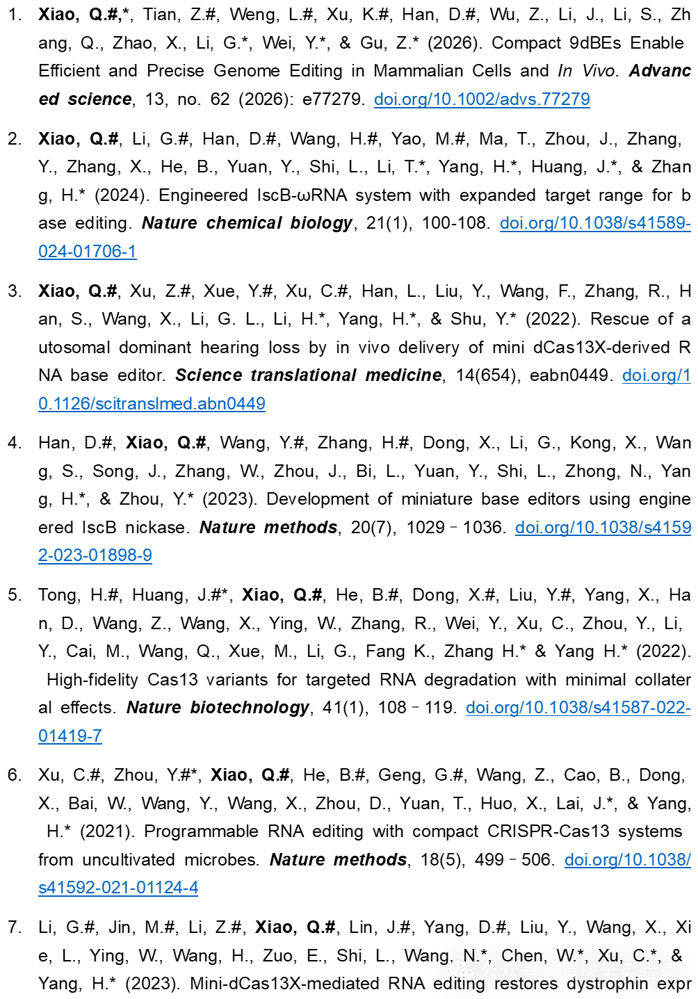

# Qingquan-Xiao-Laboratory
The Qingquan Xiao Lab

---

# PI

Qingquan Xiao, Ph.D., is a Principal Investigator at the Jinhua Institute of Zhejiang University and the School of Pharmacy, Zhejiang University, and a member of Gu iMedication Lab. He leads an independent research group focused on developing next-generation genome editing tools and gene therapies.

Prior to joining Zhejiang University, Dr. Xiao was a postdoctoral fellow at the Center for Excellence in Brain Science and Intelligence Technology (Institute of Neuroscience), Chinese Academy of Sciences. He received his Ph.D. in Neurobiology from the University of Chinese Academy of Sciences, where he conducted his doctoral research in the Non-human Primate Disease Models Laboratory, and earned his bachelor's degree in Biology from Sichuan University.

Dr. Xiao was selected for the Shanghai Postdoctoral Excellence Program, and his work has been published in *Nature Biotechnology*, *Nature Methods*, *Nature Chemical Biology*, *Science Translational Medicine*, *Advanced Science*, *Journal of Clinical Investigation*, and *Cell Discovery*, with contributions as a first, co-first, or co-corresponding author. Dr. Xiao also serves as a peer reviewer for scientific journals and academic publishers, evaluating manuscripts and book chapters.

**Email:** qqxiao@@zju.edu.cn

**Website:** [Qingquan Xiao](http://www.imedlab.net/NewsDetail.aspx?ID=860)

---

# Team

  

Our team currently consists of one postdoctoral researcher, two Ph.D. students, and five graduate students.

---

# Research Interests

  

---

# Selected Publications

*# denotes first or co-first authors.*

  

---

# Other Publications

  

---

# Patents

  

---

# Conference Presentations

  

---

# Join Us

We welcome highly motivated individuals interested in AI for Science, nucleic acid delivery, genome editing, therapeutics, and drug discovery to join our team.

---

# Disclaimer

The information on this website, including laboratory descriptions, personal profiles, research activities, and scientific achievements, is provided for informational and academic purposes only. It does not constitute medical, healthcare, diagnostic, therapeutic, or investment advice.

Information about genome editing technologies, gene therapies, and related research reflects ongoing scientific and technological developments and should not be interpreted as evidence of clinical validation, regulatory approval, or readiness for clinical application. Nothing on this website should be relied upon as a substitute for professional advice or as the basis for medical or investment decisions.

While we make reasonable efforts to ensure the accuracy and completeness of the information presented, we make no representations or warranties in this regard. We reserve the right to update, revise, or remove website content at any time without prior notice.

